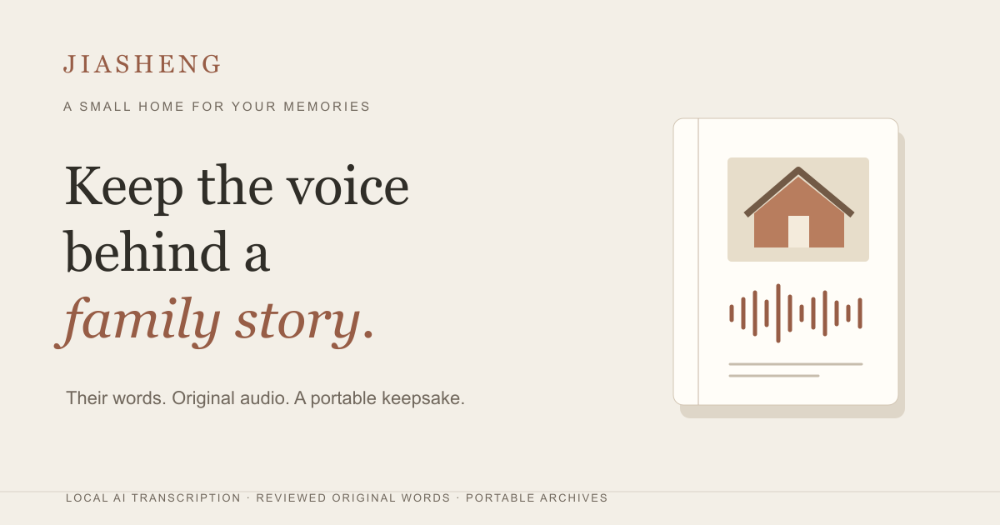

# 家聲 · Jiasheng

Turn a family conversation into a story you can hear again. Prepare a few questions, record or import a conversation, review its transcript, and make a portable story page whose quotations link back to the original audio.

[Try Jiasheng](https://jiasheng-family-stories.pages.dev/?lang=en) · [繁體中文](https://jiasheng-family-stories.pages.dev/?lang=zh-TW)



Choose **Explore a story** to explore a fictional Mandarin recording without downloading a model. The English interface includes labelled translations of that sample; the original words and audio stay unchanged. To use the actual speech model, record or import a short Mandarin conversation and choose local transcription.

## Run

```sh
npm ci
npm run dev
```

Open the printed local URL in a recent desktop Chrome browser. The production application is a static site. No inference API key, database account, Ollama installation, or server-side upload is required.

```sh
npm test
npm run build
```

## The first version

- Prepare editable, human-written conversation questions from topic presets.
- Record with the browser after confirming that participants agree, or import an audio file.
- Download the original recording immediately, before transcription or story creation.
- Transcribe locally with Whisper base. Listen, correct the wording and timestamps, and confirm the transcript before making a story.
- Arrange the reviewed passages into a story in their original order. Edit its title, chapter headings and next question yourself; the story body consists of the reviewed passages themselves.
- Click a passage to seek the actual attached recording. Text without a timestamp has no invented audio link.
- Save audio, photos and stories in this browser's IndexedDB. Export a ZIP containing an independent HTML story, original media, transcript, metadata, and a bilingual `START-HERE.txt`. Extract the entire ZIP before opening `story.html`.

## Deploy to Cloudflare Pages

The production site is a static direct-upload Pages project. With Wrangler installed and authenticated to your own Cloudflare account:

```sh
npm ci
npm run build
wrangler pages project create YOUR_PROJECT_NAME --production-branch main
wrangler pages deploy dist --project-name YOUR_PROJECT_NAME --branch main
```

For the existing Jiasheng deployment, reuse `jiasheng-family-stories` and skip project creation. `wrangler.toml` declares the output directory. Do not upload the repository root. No backend database or inference secrets are needed.

## Privacy and boundaries

Recordings, transcripts and photos stay in the browser during application use. Model and runtime files are downloaded from external hosts; those requests expose normal network metadata. First model use requires internet access and approximately 100 MB of downloads for speech recognition and its runtime. Cache retention depends on the browser. This is not a promise that an unopened or uncached site works offline.

Browser storage is local to this device, browser profile and site origin. It is not a backup. Export important recordings before clearing site data, using private browsing, or changing devices. The archive deliberately contains original family audio: share it only with the people you choose.

This version supports at most ten minutes / 100 MB of audio per transcription and 6,000 characters per pasted transcript. Whisper base may mishear Mandarin names, dates, accents and Taiwanese. It does not identify speakers. Titles, chapter headings and next questions are editable. The first release does not generate them with a language model. Source links establish where wording came from, not whether a recollection is historically true. Dates remembered uncertainly should stay uncertain.

## Demonstration provenance

The built-in example is **fictional**. Its father, first salary and radio story were written for this prototype. A stock James Gao voice was synthesized using ElevenLabs v4 through Creative Claw; it is not a cloned family member. The example chapters were manually arranged, and audio positions use provider word timings. The example is not a real interview, an AI transcription result, a user testimonial, or evidence of habit change. See `public/demo-provenance.json` for the script and alignment source.

No application feature depends on Creative Claw or ElevenLabs at runtime. Those services produced only the clearly labeled demo asset. Application inference uses the open models below.

## Models and source integrity

- [Whisper base](https://huggingface.co/openai/whisper-base), whose Hugging Face model card lists Apache 2.0; ONNX q8 encoder and decoder, pinned revision. The [upstream Whisper repository](https://github.com/openai/whisper) uses MIT. Model weights are fetched from their host, not included in this repository.
- [Transformers.js](https://huggingface.co/docs/transformers.js/v3.8.1/index) in a dedicated browser Worker with one WASM thread. Each job releases its worker after completion, cancellation or failure.

`src/workers/ai-protocol.ts` validates speech output and timestamps. The story binds every original passage directly to its source, without model-selected grouping or rewriting. `src/domain.ts` validates the resulting story. Raw source text is escaped in HTML exports. A failed AI job never silently becomes a prerecorded success.

**Release decision:** Qwen2.5-0.5B and Qwen3-0.6B experiments did not produce consistently useful interview questions. Their development harness, implementation and failure evidence remain for inspection, but language-model features are absent from the released interface and those weights are not downloaded through it. Whisper transcription is the working open-model feature.

See [AI implementation](docs/ai-implementation.md) for exact models, revisions, limits and the real-inference test procedure. Unit tests protect structural boundaries; they do not measure conversational or transcription quality.

## License

Application source is MIT. Downloaded model weights and third-party packages retain their own licenses. The generated demonstration audio is identified separately and is not covered by the application's MIT source-code license. No real family content is distributed in this repository.
